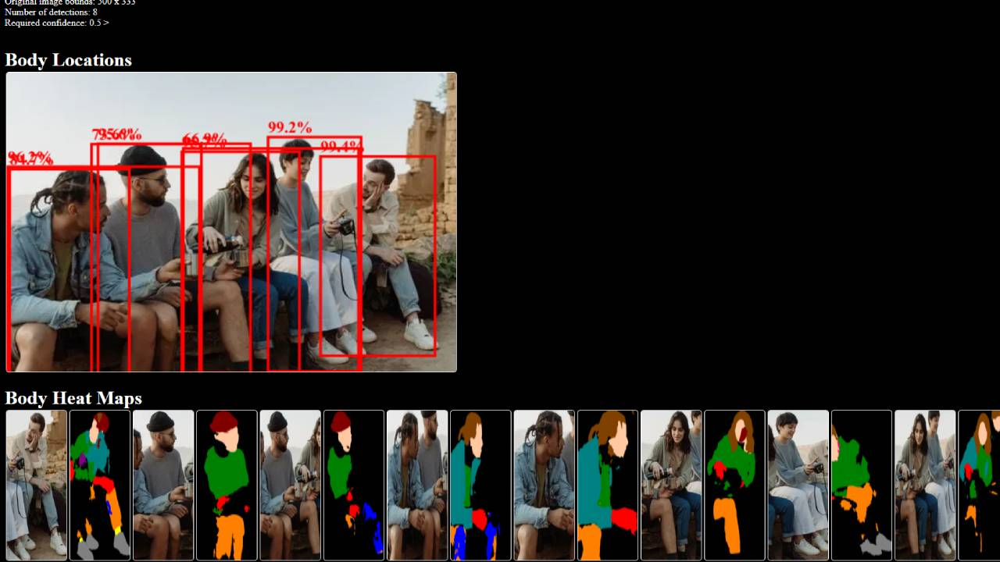

# Human Heat
Detect and segment the body parts of all people in a given image.
Fist crack at AI stuff confusing ngl.

## Example

## How to start
1) Run the export model python script to grab the required models and hopefully put them in a models directory. If that fails just grab em off hugging face.

2) All the output paths are hardcoded cause I'm stupid so you'll have to change those in index.js and the input one in preload_overlay.js 
